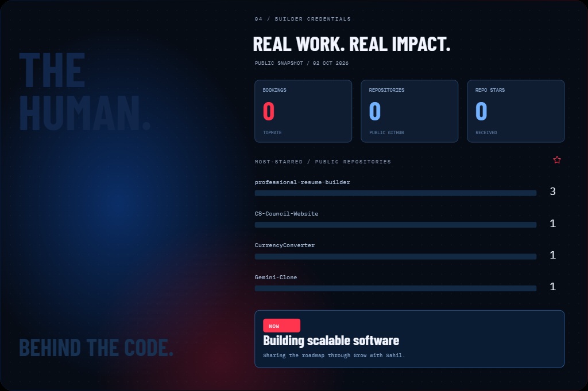

  

---

## 📊 Live Metrics & GitHub Stats

  
  

  

---

### 🛠️ Infrastructure, Cloud & Development Toolkit

| Linux | Terraform | Jenkins | Kubernetes | Ansible | Ubuntu | Git | Docker | GitHub | VS Code | AWS |
|:---:|:---:|:---:|:---:|:---:|:---:|:---:|:---:|:---:|:---:|:---:|
|  |  |  |  |  |  |  |  |  |  |  |

  
  
  
  
  
  

> “First solve the problem. Then, write the code.” – John Johnson

---

### 🚀 Things I've Built & Maintained

| Project | What it does | Focus |
| :--- | :--- | :--- |
| [**Professional Resume Builder**](https://github.com/sahilshaikh867/professional-resume-builder) | ATS-friendly interactive career resume builder with real-time formatting & export | React · Full Stack · UX |
| [**CS Council Website**](https://github.com/sahilshaikh867/CS-Council-Website) | Official academic department hub & community portal for campus tech activities | Web Dev · UI/UX · Community |
| [**Gemini Clone**](https://github.com/sahilshaikh867/Gemini-Clone) | Conversational AI web platform powered by Google Gemini API streaming responses | GenAI · LLM APIs · Cloud |
| [**Currency Converter**](https://github.com/sahilshaikh867/CurrencyConverter) | Real-time exchange rate calculation tool with dynamic currency API integration | JavaScript · REST APIs · Tools |

---

## 📝 Technical Articles & Insights

Stay updated with my thoughts, tips, and DevOps field notes:

- ✨ [Docker Networking Essentials](https://www.linkedin.com/in/sahilshaikh867/) — _Understand how containers talk in a distributed ecosystem._
- 🧠 [Kubernetes Architecture for Beginners](https://www.linkedin.com/in/sahilshaikh867/) — _Deconstructing Pods, Nodes, and Ingress controllers._
- ☁️ [AWS S3 Architecture & Security Tips](https://www.linkedin.com/in/sahilshaikh867/) — _Policies, buckets, encryption, and lifecycle optimization._
- 🐳 [Debugging Docker Exit Codes](https://www.linkedin.com/in/sahilshaikh867/) — _Root cause analysis when your runtime containers crash._

---

## 🌱 Contribution Graph

  <picture>
    <source media="(prefers-color-scheme: dark)" srcset="https://raw.githubusercontent.com/platane/snk/output/github-contribution-grid-snake-dark.svg" />
    <source media="(prefers-color-scheme: light)" srcset="https://raw.githubusercontent.com/platane/snk/output/github-contribution-grid-snake.svg" />
    
  </picture>

<h2 align="center">📈 GitHub Activity Graph</h2>

  

  

---

  <!-- Interactive Social & Portfolio Badges -->
  
  &nbsp;
  
  &nbsp;
  
  &nbsp;
  
  &nbsp;
  

    

  <!-- Featured CTA Card -->
  

    

  <!-- Terminal Quote Banner -->
  <table border="0" cellpadding="0" cellspacing="0">
    <tr>
      <td align="center" style="background:#0b1323; border:1px solid #1a2a46; border-radius:12px; padding:14px 28px;">
        ⚡ Turning curiosity into production-grade systems. Code is the tool; impact is the point.
         
        Crafted with ❤️ by <b>Sahil Shaikh</b>
      </td>
    </tr>
  </table>

